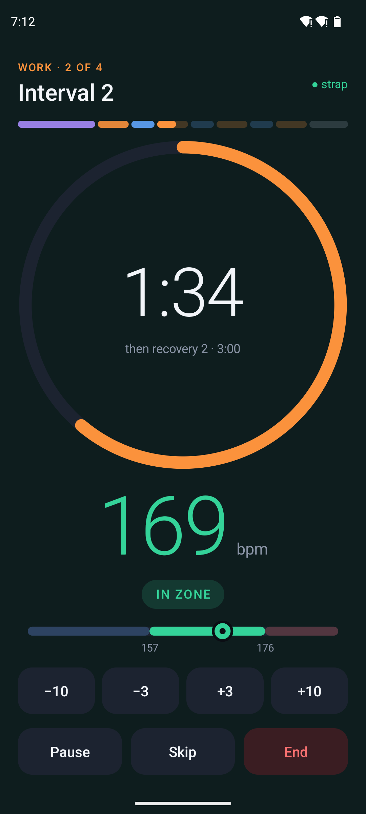
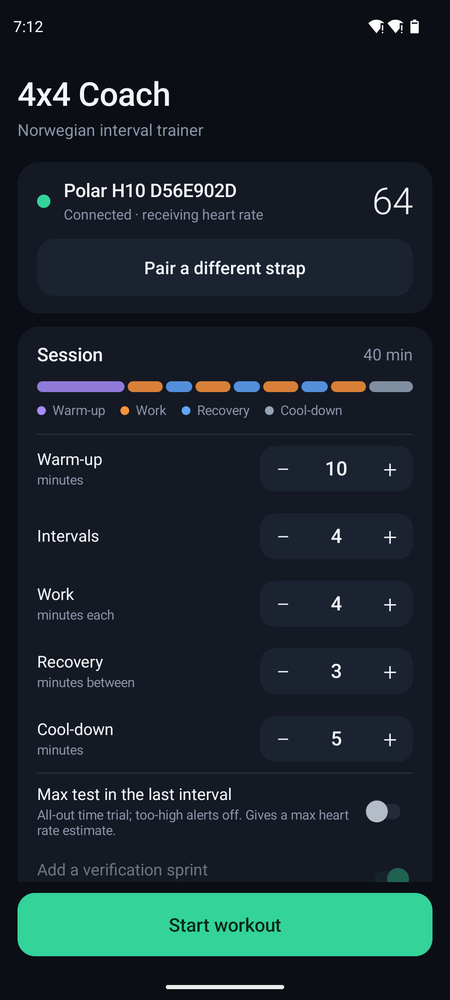
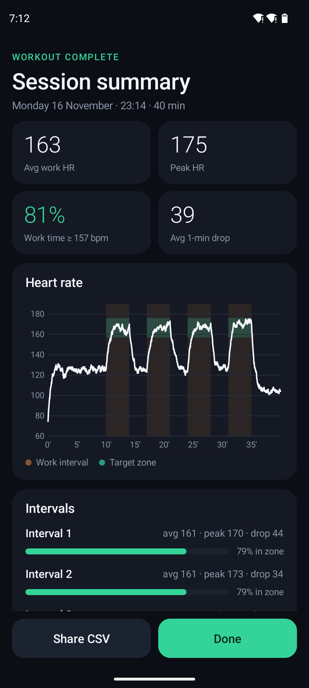
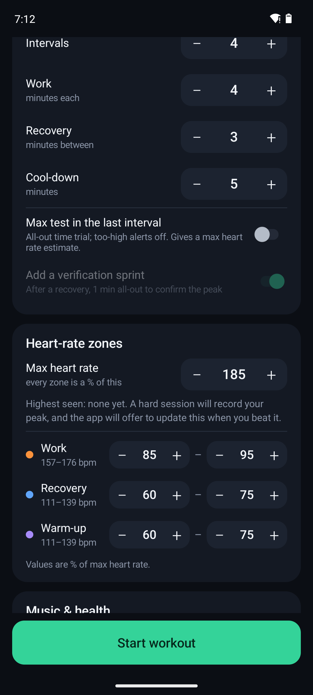
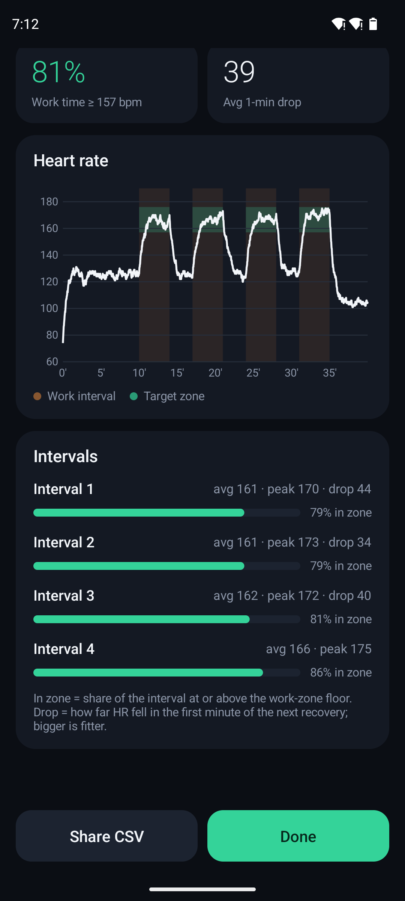

# 4x4 Coach

An Android app for **Norwegian 4x4 interval training** with a **Polar H10** (or any standard Bluetooth heart-rate strap). It runs the session, tells you the moment your heart rate leaves the target zone, and learns your real max heart rate so the zones are right.

Built because the existing apps were buggy, and because the 4x4 only works if you actually spend the time at 85–95% of max. [Why the protocol is worth doing →](docs/norwegian-4x4.md)

<p>
  
  
  
</p>

## What it does

**During the workout**
- Warm-up, 4 × (4 min work / 3 min recovery), cool-down. All durations and the number of intervals can be changed.
- Each phase has its own target zone as a % of max heart rate (defaults: work 85–95%, recovery and warm-up 60–75%).
- A tone, spoken cue ("too high" / "too low") and vibration when you leave the zone; a ding when you're back. Music ducks while it speaks.
- **Ramp grace**: no "too low" alerts for the first 60 s of each work interval, and no "too high" for the first 60 s of each recovery, while heart rate catches up. Hold time and hysteresis stop it nagging when you sit on a boundary. All adjustable.
- Runs as a foreground service, so it keeps working with the screen locked and the phone in a pocket.
- Optional **next song** command at the start of each interval and/or recovery (the same signal as a headphone button, so it works with Tidal, Spotify, etc.).
- Choice of text-to-speech voice and speech rate.

**Max heart rate**
- Records a robust peak (5-sample median) every session and offers to raise your max when you beat it.
- Optional **max test**: the last interval becomes an all-out 4-minute time trial with effort cues, optionally followed by a 1-minute verification sprint. The summary reports an estimated max and whether the sprint confirmed it. ([background](docs/norwegian-4x4.md#the-catch-you-have-to-actually-hit-the-zone))

**After the workout**
- Summary with average work heart rate, peak, % of work time in zone, and 1-minute heart-rate drop after each interval (a useful fitness trend).
- Session heart-rate chart with work intervals and target band shaded.
- CSV saved on the phone and shareable; optional export to **Health Connect** (exercise session + heart-rate samples).

**Reliability**
- Strap connection scans before connecting, retries with backoff, and reconnects mid-workout.
- The in-progress session is written to disk every second. If Android kills the app it restarts and resumes; if more than 15 minutes have passed, the session is kept as finished.
- On-screen connection log (Advanced → Connection log) for debugging.

<p>
  
  
</p>

## Install

Every push to `main` builds a signed APK and attaches it to the [**latest** release](../../releases/tag/latest).

1. Open the release page on your phone and tap `hr4x4-coach.apk`.
2. Allow installs from your browser when Android asks.
3. Open the app and grant Bluetooth (nearby devices) and notification permissions.

New builds install over old ones and keep your settings. The signing key is committed (`app/signing.keystore`) so that every CI build has the same signature. That's fine for a personal sideloaded app; don't reuse the key for anything published.

## Using it

1. **Wear the strap with damp electrodes**: the H10 only advertises when it detects a heartbeat. Close other apps that might be holding a connection to it.
2. Tap **Find strap**. If it's the only strap nearby, it connects automatically after three seconds.
3. **Set your max heart rate.** If you don't know it, start with your best guess and turn on **Max test** for a session or two.
4. Tap **Start workout**. Lock the phone if you like; the alerts keep going.

To try it without a strap: **Advanced → Simulated heart rate**, then use the ± buttons on the workout screen to push heart rate out of zone.

## Development

Plain Kotlin and Android Views, no Compose and no third-party libraries apart from AndroidX Core, Health Connect and coroutines. The UI is built in code (`MainActivity.kt`, `Widgets.kt`).

| File | What it does |
|---|---|
| `Engine.kt` | Workout state machine: plan, phase clock, zone logic (hysteresis, hold time, ramp grace), cues, max-test maths. Main-thread only. |
| `WorkoutService.kt` | Foreground service: owns the strap, ticks the engine, plays sounds and speech, media keys, notification, resume after a kill. |
| `HrBle.kt` | Bluetooth LE Heart Rate Service client: scan-then-connect, retries, timeouts, notification parsing. |
| `SessionStore.kt` | Writes the in-progress session to disk; resume or recover after a crash. |
| `HealthSync.kt` | Health Connect permissions and export. |
| `Sounds.kt` | Synthesised alert tones (AudioTrack) with audio ducking, plus vibration. |
| `Widgets.kt` | Design tokens and custom views: ring, timeline, zone gauge, heart-rate chart. |
| `MainActivity.kt` | Setup, workout and summary screens; scanning; voice picker. |

**Builds** run on GitHub Actions (`.github/workflows/build.yml`) with Gradle 8.7, AGP 8.5, Kotlin 1.9, compile/target SDK 34, min SDK 26.

**Screenshots** come from `.github/workflows/screenshots.yml` (run it manually from the Actions tab). It boots an emulator, installs the APK and uses the demo hooks:

```sh
adb shell am start -n com.gshotwell.hr4x4/.MainActivity --es demo setup    # fake connected strap
adb shell am start -n com.gshotwell.hr4x4/.MainActivity --es demo workout  # simulated workout, mid-interval 2
adb shell am start -n com.gshotwell.hr4x4/.MainActivity --es demo summary  # synthetic finished session
```

## Disclaimer

This is a personal training tool, not a medical device. Near-maximal intervals and max tests are hard on the heart by design. If you have a heart condition or are new to hard exercise, check with a doctor first.
